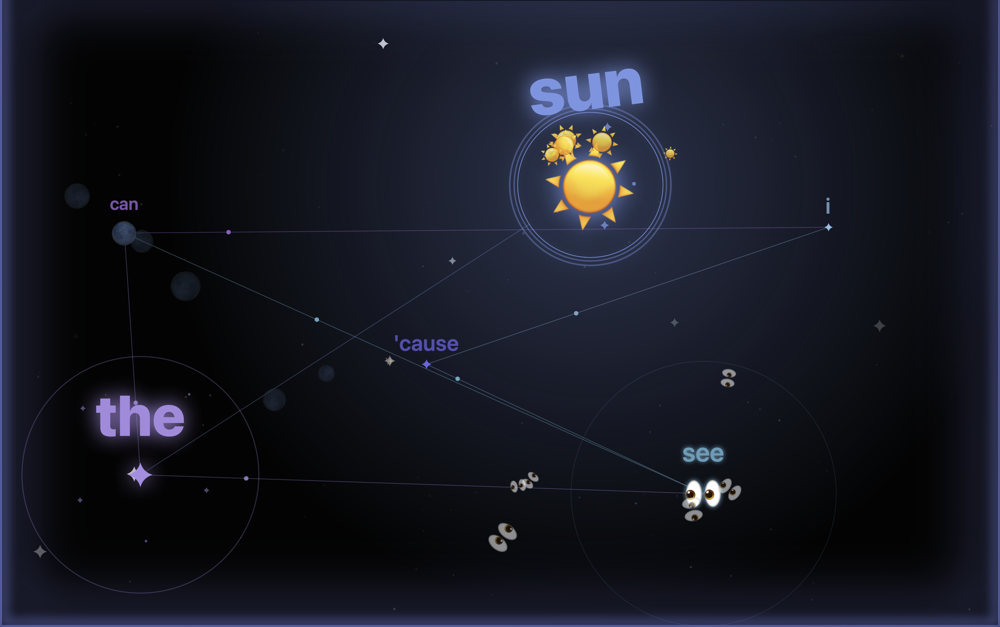
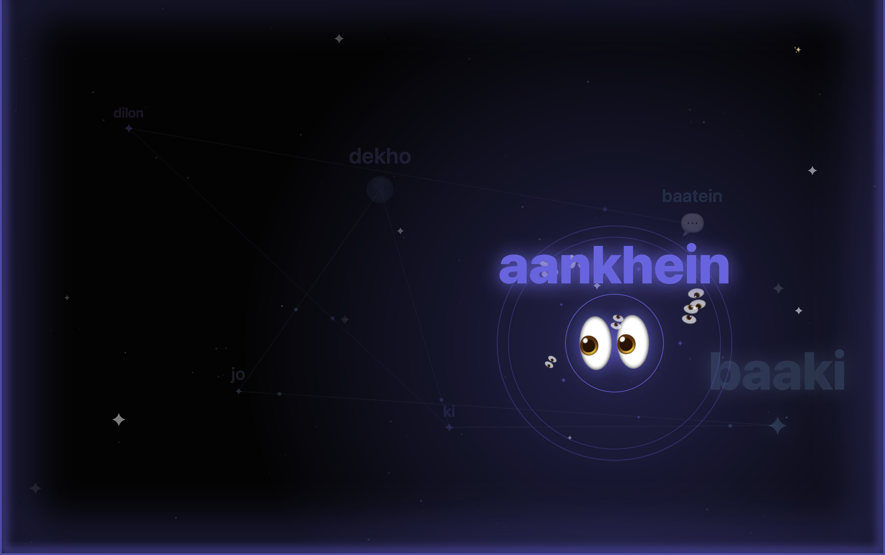
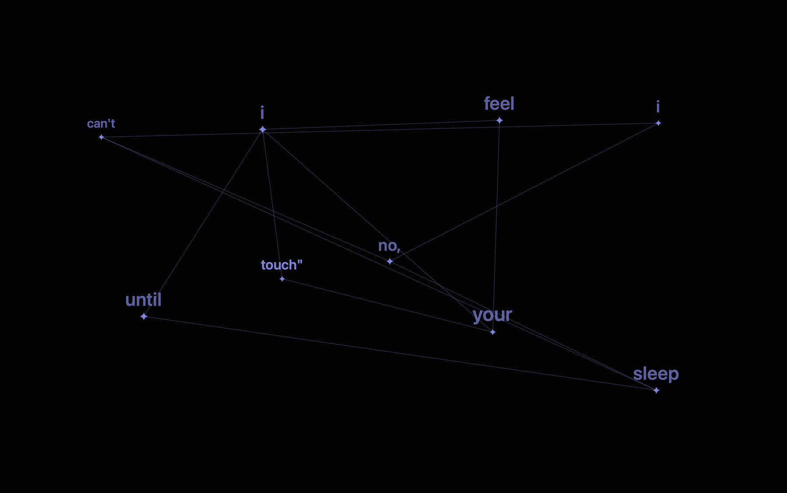
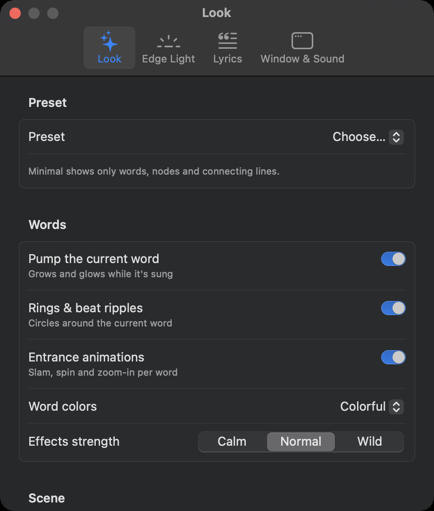

<div align="center">

# ✨ Lyrcing

### Your music, as a living constellation.

Every lyric word becomes a glowing star, connected to the next, in time with the song —
with emoji that match the words, ambient effects that follow the song's mood,
and a screen-edge light that changes color with every word.




</div>

---

## What it does

Lyrcing is a native macOS app that listens to what's playing in **Spotify** or **Apple Music**, finds time-synced lyrics, and turns them into an animated, interactive-feeling scene:

- 🌌 **Constellation lyrics** – each word lands as a star at a random spot, joined to earlier words by thin glowing lines with light travelling along them. The word being sung grows, glows and gets a ring; earlier words shrink into small labels.
- 🎨 **A new color for every word** – colors step around the color wheel from the album's palette.
- 😍 **Emoji that understand the words** – ☀️ for *sun*, 👀 for *aankhein*, 💔 for *dard*. Emoji words burst into a fan of emoji that fall back with gravity.
- 🌙 **Mood-aware** – the app reads the lyrics' sentiment. A sad song gets cool, soft colors and quiet effects, with **no hearts, confetti or party emoji**. Happy songs get brighter, bolder effects.
- 💡 **Edge light** – a glowing frame around your screen whose color follows the word being sung.
- 🥁 **Beat sync (optional)** – listens to your Mac's audio output and punches rings, zoom and light on every beat.
- 🌍 **Built for English, Hindi, Punjabi and more** – prefers roman-script lyrics (English / Hinglish / Punjabi in English letters) and falls back to the original script when no roman version exists.
- 🎛️ **Everything is customisable** – every effect has its own switch, with Full / Balanced / **Minimal** presets.

<table>
<tr>
<td width="50%"><br><sub><b>Hindi in roman letters</b> – "aankhein" → 👀, calm palette for a sad song</sub></td>
<td width="50%"><br><sub><b>Minimal preset</b> – just words, nodes and connecting lines</sub></td>
</tr>
</table>

## Customise everything

Open **Settings (⌘,)** or use the **Look**, **Edge Light** and **Playback** menus in the menu bar.

<div align="center">

</div>

| Area | Options |
| --- | --- |
| **Presets** | Full · Balanced · Minimal (words, nodes & lines only) |
| **Words** | Pump the current word · rings & beat ripples · entrance animations (slam / spin / zoom) · colors: Colorful / Album / White |
| **Scene** | Connection lines · light sparks · sparkle burst · color glow · twinkling stars · ambient particles · camera motion |
| **Emoji** | Emoji on/off · emoji explosions on/off |
| **Edge light** | On/off · soft glow or thin line · color (follow lyrics / warm white / custom hue) · brightness · thickness · pulse on lyric lines |
| **Lyrics** | Constellation or Classic scrolling style · text size · prefer English/roman lyrics · mood (Auto / Sad / Mixed / Happy) · effects strength (Calm / Normal / Wild) |
| **Window & sound** | Beat sync · player bar (auto-hide / always / hidden) · keep window on top · reset to defaults |

**Keyboard shortcuts**

| Shortcut | Action |
| --- | --- |
| `Space` · `←` · `→` | Play/pause · previous · next |
| `⌘L` | Toggle edge light |
| `⌘1` `⌘2` `⌘3` | Full / Balanced / Minimal preset |
| `⌥⌘E` | Toggle emoji |
| `⌥⌘B` | Toggle beat sync |
| `⌘+` `⌘-` `⌘0` | Text size |
| `⌥⌘T` | Keep window on top |
| `⌘,` | Settings |

## Install

### Download (easiest)

1. Download **`Lyrcing-1.0.0.dmg`** from the [latest release](https://github.com/yuvraj0011/lyrcing/releases/latest) (universal: Apple Silicon and Intel, macOS 14+).
2. Open the DMG and drag **Lyrcing** into **Applications**.
3. First launch: the build is not notarized by Apple yet, so macOS will warn about it.
   - **macOS 14:** right-click the app → **Open** → **Open**.
   - **macOS 15 or later:** try to open it once, then go to **System Settings → Privacy & Security**, scroll down and click **Open Anyway**.
   - Or, in Terminal: `xattr -dr com.apple.quarantine /Applications/Lyrcing.app`

You only have to do this once. If you would rather not run an unsigned download, build it yourself:

### Build from source

Requires **macOS 14+** and the Xcode Command Line Tools (Swift 5.9+). Full Xcode is *not* required.

```bash
git clone https://github.com/yuvraj0011/lyrcing.git
cd lyrcing
./scripts/build_app.sh        # builds a universal dist/Lyrcing.app and dist/Lyrcing.dmg
open dist/Lyrcing.app
```

A build you make yourself on your own Mac opens normally.

### First run

1. Start playing a song in Spotify or Apple Music.
2. macOS asks to let Lyrcing control Spotify / Music – **Allow** (this is how it reads the current track and position).
3. *(Optional)* Press `⌥⌘B` to turn on beat sync. macOS will ask for **Screen Recording** permission; Lyrcing only reads your Mac's **audio** output, never your screen.

## How it works

```
 Spotify / Music ──AppleScript──▶ NowPlayingMonitor ──▶ AppModel ──▶ SwiftUI views
                                         │                 │
                      LRCLIB lyrics ◀────┤                 ├─▶ ConstellationView (SwiftUI Canvas, 60 fps)
                      iTunes cover art ◀─┘                 ├─▶ EdgeLightController (click-through NSPanel per screen)
                                                           ├─▶ Lexicon  (word → emoji, many languages)
                                                           ├─▶ Sentiment (lyrics → Sad / Mixed / Happy)
                                                           └─▶ AudioReactor (ScreenCaptureKit audio → beat pulse)
```

- **Rendering is stateless.** Every frame is a pure function of *(lyrics, playback position)*, so seeking, pausing and track changes just work. Redraws stop while paused.
- **Word timing** is estimated by spreading each line's time over its words by syllable count (LRCLIB provides per-line timestamps). Beat sync is what locks the effects to the actual audio.
- **Lyrics selection** searches LRCLIB, keeps the version whose length matches the track, prefers synced over plain, and prefers roman script over native script.
- **Emoji lookup** layers hand-picked English/Hindi/Punjabi song words → Unicode CLDR annotations for 20 locales. Indic and Arabic scripts are matched through an ICU transliteration "consonant skeleton" so *प्यार*, *ਪਿਆਰ*, *pyaar* and *pyar* all resolve to the same emoji. It is tuned for precision: a missing emoji is better than a wrong one.
- **Mood** combines Apple's on-device `NaturalLanguage` sentiment (English) with word lists for Hinglish/Punjabi/Urdu and native scripts. When unsure it stays calm.

### Project layout

```
Sources/Lyrcing/
  LyrcingApp.swift      app entry, scenes, menu commands wiring
  Commands.swift        menu-bar menus (Playback · Look · Edge Light · Window)
  AppModel.swift        state, persisted settings, presets
  NowPlaying.swift      Spotify / Music polling + controls (AppleScript)
  Lyrics.swift          LRCLIB client, LRC parser, version selection
  Artwork.swift         cover art + color palette extraction
  Constellation.swift   the constellation renderer (Canvas)
  Lexicon.swift         multilingual word → emoji
  Emoji.swift           curated English emoji table
  Sentiment.swift       mood detection and per-mood theming
  AudioReactor.swift    audio capture + beat detection
  EdgeLight.swift       screen-edge light overlay
  Views.swift          window UI, classic lyrics view, Settings tabs
Resources/emoji_index.json   generated from Unicode CLDR
scripts/build_app.sh         builds the .app and .dmg
scripts/build_lexicon.py     regenerates the emoji index from CLDR
```

### Development notes

- `LYRCING_FAKE_BEAT=1 open dist/Lyrcing.app` simulates a beat so you can preview beat effects without granting Screen Recording.
- Errors from reading the player are logged to `~/Library/Logs/Lyrcing.log`.
- `python3 scripts/build_lexicon.py` re-downloads the CLDR annotations and rebuilds `Resources/emoji_index.json`.

## Privacy

- No account, no analytics, no tracking.
- Lyrcing sends the **track title, artist, album and duration** to LRCLIB and iTunes to find lyrics and cover art – nothing else.
- Beat sync reads audio **levels** in memory only. Audio is never stored or sent anywhere.
- Settings are stored locally in macOS user defaults.

## Roadmap

- [ ] Word-level timing for songs that provide it
- [ ] Live Apple Music testing across more setups
- [ ] Light-mode and accessibility options (reduced motion)
- [ ] App Store build (sandbox entitlements, notarization)
- [ ] More emoji for Latin-script languages (Spanish, Portuguese, …)

Ideas and pull requests are welcome – open an issue to discuss.

## Credits

Created by **[Yuvraj Pandey](https://github.com/yuvraj0011)**.
Lyrics from [LRCLIB](https://lrclib.net) · emoji keywords from [Unicode CLDR](https://github.com/unicode-org/cldr). See [NOTICE.md](NOTICE.md) for details.

Lyrics belong to their respective rights holders; Lyrcing does not store or redistribute them. Lyrcing is not affiliated with Spotify, Apple or LRCLIB.

## License

[MIT](LICENSE) © 2026 Yuvraj Pandey
